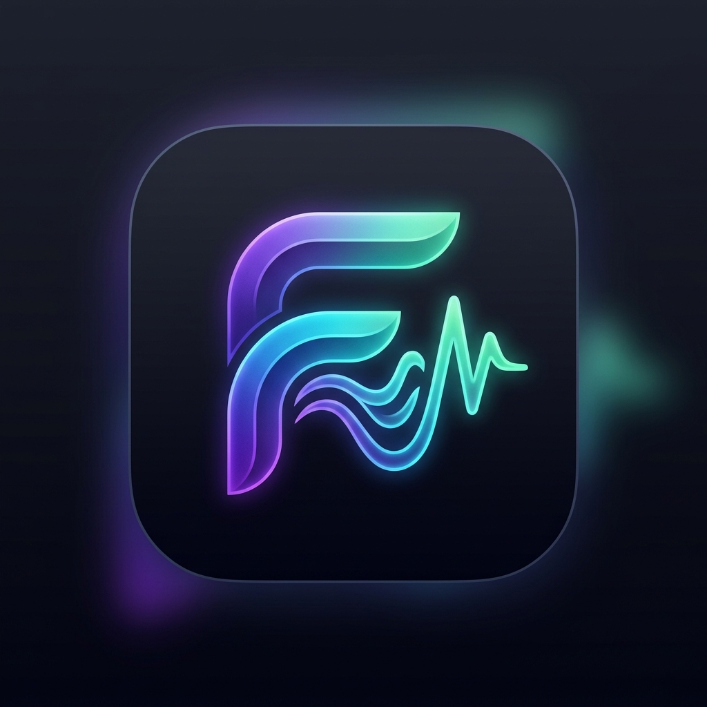

<div align="center">



# Fiend

**Modern, audiophile-grade YouTube Music client for Android with Liquid Glass aesthetics, AMOLED Obsidian styling, and Bit-Perfect audio.**

<br/>

[](https://github.com/Eurt-labs/Fiend/releases)
[](https://t.me/fiend_music)
[](https://t.me/eurtXacro)
[](https://github.com/acro777x/Fiend-Desktop)
[](https://github.com/Eurt-labs/Stash)

</div>

---

## ✦ Highlights

Fiend is an open-source, high-performance music client designed for speed, visual elegance, and uncompromising audio fidelity. Crafted by **Eurt Labs** and **ACRO**, Fiend combines responsive Material 3 Expressive architecture with fluid backdrop refraction, deep AMOLED Obsidian black surfaces, and studio-grade sound processing.

- 💎 **Liquid Glass UI & AMOLED Obsidian Theme** — Glassmorphic cards, adaptive real-time blur shaders, fluid spring physics, and neon electric cyan accents.
- 🎚️ **Bit-Perfect Audiophile Engine** — Direct USB DAC hardware bypass, 15-band parametric equalizer, and AutoEQ target profiles for over 2,500 headphones and IEMs.
- 🔄 **Resilient Playback** — Built-in auto-reconnection and exponential chunk retry to eliminate mid-song stream dropouts on high-speed connections.
- 🎤 **Millisecond-Synced Lyrics** — Real-time live lyrics with dynamic word animations, Romanization for non-Latin alphabets, and interactive share cards.
- 👥 **Fiend Jam** — Real-time collaborative listening sessions with friends over ultra-low-latency WebSocket relays.
- 📥 **Offline & Background Playback** — Cache tracks, download high-bitrate audio with embedded cover art, and enjoy seamless background lockscreen controls.

---

## ✦ Features Matrix

<table>
  <tr>
    <td width="50%" valign="top">

### 🎧 Audio & Engine
- **Bit-Perfect Audio:** Native USB Audio Driver routing to DACs without Android OS audio mixer resample degradation.
- **Parametric EQ & AutoEQ:** Calibrated frequency responses for hundreds of headphone models with customized peaking and shelving filters.
- **Modular Addons:** Hi-Res 24-bit FLAC support via modular lossless streaming pipelines.
- **Automix & Crossfade:** Intelligent tempo-matched track transitions and configurable crossfade intervals.
- **Dynamic Volume:** ReplayGain and LUFS loudness normalization to protect hearing across diverse masters.

</td>
    <td width="50%" valign="top">

### 🎨 Visuals & Design
- **Liquid Glass Architecture:** Real-time runtime blur backdrops with dynamic refraction shaders.
- **AMOLED Obsidian Signature:** Deep `#050811` dark surface paired with radiant `#00D2FF` electric cyan and `#818CF8` neon violet accents.
- **Customizable App Icons:** High-contrast launcher emblems including Original Signature, Desktop Blue, Pure White, and Obsidian Black.
- **Fluid Micro-Animations:** Staggered splash screen entrance with responsive equalizer bars and pulsing ambient glow.

</td>
  </tr>
  <tr>
    <td width="50%" valign="top">

### 🔍 Discovery & Library
- **YouTube Music Catalog:** Unlimited access to tracks, full albums, live sessions, remixes, and curated playlists.
- **Spotify Integration:** Import public playlists, view Spotify Canvas animations, and map favorite songs seamlessly.
- **Intelligent Radio & Mixes:** Contextual mood selectors, taste-seeded suggestions, and automated endless queues.
- **Tag Editor & Metadata:** Edit ID3 metadata, embedded lyrics, and custom high-resolution album artwork.

</td>
    <td width="50%" valign="top">

### 🌐 Social & Ecosystem
- **Fiend Jam Sessions:** Host or join live music rooms with friends and synchronized queue management.
- **Companion Ecosystem:** Direct ecosystem bridge to [Stash](https://github.com/Eurt-labs/Stash) and [Fiend Desktop](https://github.com/acro777x/Fiend-Desktop).
- **Update Radar:** Automatic in-app update checks tracking official GitHub releases.
- **Privacy First:** Zero tracking, zero analytics telemetry, and entirely open-source.

</td>
  </tr>
</table>

---

## ✦ Downloads & Installation

### Android APK

| Variant | Channel | Link | Minimum System |
|:---|:---|:---|:---|
| **Universal Release** | Stable | [Download Fiend v2.1.0](https://github.com/Eurt-labs/Fiend/releases) | Android 7.0+ (API 24+) |
| **Desktop Companion** | Multiplatform | [Fiend Desktop](https://github.com/acro777x/Fiend-Desktop) | Windows / Linux / macOS |

#### Quick Start:
1. Download the latest `app-release.apk` from [Releases](https://github.com/Eurt-labs/Fiend/releases).
2. Install on your Android device (ensure "Install from unknown sources" is enabled if prompted).
3. *(Optional)* Head to **Settings → Audio & Engine** to enable **Bit-Perfect DAC output** or choose an **AutoEQ** preset for your headphones.

---

## ✦ Building from Source

### Requirements
- **JDK:** OpenJDK 17 or 21
- **Android SDK:** Platform 35 with Build Tools 35.0.0
- **NDK & CMake:** NDK 26+ and CMake 3.22+ (for native C++ USB audio engine)

### Commands

```bash
# 1. Clone the repository
git clone https://github.com/Eurt-labs/Fiend.git
cd Fiend

# 2. Build production release APK
./gradlew assembleRelease -PtargetAbis=arm64-v8a

# Output APK path:
# app/build/outputs/apk/release/app-release.apk
```

---

## ✦ Community & Support

Have questions, suggestions, or want to follow upcoming updates? Connect with us:

- 💬 **Telegram Support Group:** [@fiend_music](https://t.me/fiend_music)
- 📢 **Eurt Labs & ACRO Channel:** [@eurtXacro](https://t.me/eurtXacro)
- 🗃️ **Ecosystem Products:** [Stash](https://github.com/Eurt-labs/Stash)

---

## ✦ Acknowledgements

Fiend is made possible through open-source innovation and community contributions:
- **InnerTune & Metrolist** — InnerTube streaming architectures
- **Decent USB Audio Driver** — Hardware-direct USB DAC driver
- **AutoEQ** — Headphone & IEM acoustic compensation presets
- **LRCLIB** — Synchronized lyrics service
- **Kyant** — Real-time backdrop refraction shaders

---

## ✦ Disclaimer

Fiend is an independent open-source client developed by **Eurt Labs** and **ACRO** for educational, experimental, and personal use. Fiend does not host or distribute copyrighted media files; all streams are resolved directly from public services. All product names, trademarks, and registered trademarks belong to their respective owners.

<div align="center">
  <br/>
  <b>Crafted with passion by Eurt Labs & ACRO</b>
</div>
